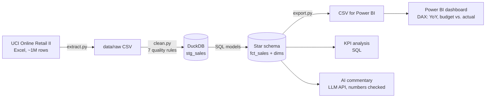
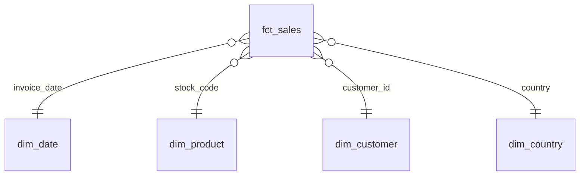

# Retail Sales KPI Reporting with AI-Generated Commentary

An end-to-end reporting project on real e-commerce data: Python and SQL clean and model about one million sales lines, a **Power BI** dashboard tracks the KPIs, and an **LLM** writes a monthly commentary from the validated numbers.

**Tech stack:** Python · SQL · DuckDB · Power BI (DAX) · OpenAI / Anthropic API · Git

> Status: data pipeline, star schema and KPI analysis done. Power BI dashboard and AI commentary in progress.

## Architecture



| Step | What happens | Code |
|---|---|---|
| Extract | Downloads the dataset once and combines its two Excel sheets into one CSV | `pipeline/extract.py` |
| Clean | Labels every row with the first data quality rule it breaks; nothing is silently dropped | `pipeline/clean.py` |
| Model | Builds the star schema and an assumed monthly budget in DuckDB with SQL | `sql/` |
| Export | Writes the tables as CSV files for Power BI | `pipeline/export.py` |
| Analyse | Answers 7 business questions with SQL (YoY, budget vs. actual, top products, price comparison) | `analysis/` |

## Data model (star schema)



- **fct_sales**: one row per valid sales line (quantity, unit price, revenue)
- **dim_product**: product with its most frequent description and average price
- **dim_customer**: first purchase, number of orders, lifetime revenue ("Guest" for orders without a customer ID)
- **dim_country**: country and market (Domestic UK / International)
- **dim_date**: calendar attributes
- **monthly_budget**: actual vs. an **assumed** budget (the dataset has no real budget, so the 2011 plan is the same month in 2010 + 5%)

## Data quality rules

| Rule | Why it matters |
|---|---|
| `duplicate_row` | The two Excel sheets overlap in December 2010; duplicates would double-count revenue |
| `cancelled_original_sale` | A sale that a later "C" invoice fully reverses (same customer, product, quantity and price). Without this rule, cancelled orders would have overstated revenue by about £547k (2.9%) |
| `cancelled_invoice` | Invoices starting with "C" are cancellations, not sales |
| `non_product_code` | Postage, bank charges, manual adjustments and test codes are not product sales |
| `non_positive_quantity` | Returns or errors would distort units and revenue |
| `non_positive_price` | Free items or data errors |
| `missing_description` | A product can't be reported without a name |

## How to run

```bash
python -m venv .venv
.venv\Scripts\activate          # Windows  (macOS/Linux: source .venv/bin/activate)
pip install -r requirements.txt
python pipeline/run_pipeline.py      # downloads, cleans, models and exports
python analysis/run_analysis.py      # writes analysis/results.md
```

## Results (Dec 2009 - Dec 2011, ~1.07 million sales lines)

**Data quality**
- Loaded **1,067,371** raw sales lines; **997,181 (93.4%)** passed all 7 quality rules.
- Biggest issue: **duplicate rows** (34,335 rows, 3.2%), mostly from the overlap between the two source sheets.
- **Cancelled orders were the most misleading issue.** My first run removed the cancellation lines but still counted the original sales. Matching each cancellation to the sale it reverses removed **6,146 sales and £547k (2.9%) of revenue that never happened**, and it changed conclusions: January 2011 went from **+9.5%** to **-7.1%** year-over-year, and a product that had looked like a top-4 bestseller (one cancelled order of 80,995 units) dropped out of the top 10.

**Business insights**
- **Revenue was flat in 2011** (£9.09M vs. £9.21M, -1.3%): **orders fell 7%**, but the **average order value rose 6%** (£502 vs. £473). Fewer, larger orders.
- **Strong seasonality:** revenue peaks in **September to November** (Nov 2011: £1.44M), and the strongest growth was in **September (+19%)** and **May (+17%)**. Dec 2011 is a partial month (data ends 9 Dec), so its drop is not a real decline.
- **Budget vs. actual** (assumed plan: 2010 + 5%): 2011 **missed the plan from January to April** (worst: April, -24%) and **beat it from May onwards**.
- **Repeat customers drive 84% of revenue**, one-time customers only 3%; guest orders without a customer ID add 13.5%.
- **85.5% of revenue is domestic (UK).** The largest international markets are Ireland (3.2%), the Netherlands (2.9%) and Germany (2.0%).
- **International customers pay less per unit** for all 10 best-selling products (e.g. Jumbo Bag Red Retrospot: £2.36 UK vs. £1.96 abroad), which points to bulk or wholesale pricing.

Full query results: [analysis/results.md](analysis/results.md)

## Next steps

- [ ] Power BI dashboard with DAX measures (YoY %, budget vs. actual, top products, price comparison)
- [ ] Monthly AI commentary generated from validated KPIs, with a check that every number matches the data
- [ ] Automate the monthly run

Data source: [UCI Machine Learning Repository - Online Retail II](https://archive.ics.uci.edu/dataset/502/online+retail+ii) (CC BY 4.0)
